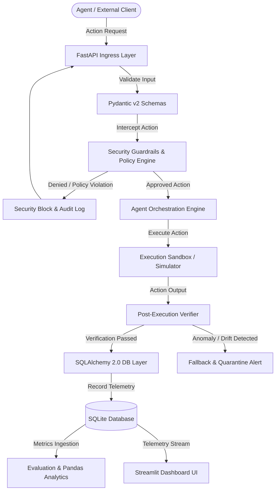

# AGENTGUARD Architecture Documentation

## 1. System Overview

**AGENTGUARD** is an enterprise-grade, task-aware runtime security and reliability framework for autonomous AI agents. Autonomous agents execute multi-step tasks across APIs, filesystems, and databases. AGENTGUARD provides deterministic policy enforcement, pre-execution interception, post-execution verification, and continuous reliability evaluation.

---

## 2. Architectural Boundaries & Module Responsibilities

The codebase enforces strict separation of concerns across dedicated subsystems:

```
agentguard/
├── backend/
│   ├── api/          # Web API Layer (FastAPI Routers & Schemas)
│   ├── core/         # Cross-Cutting Infrastructure (Config, Logging, Exceptions)
│   ├── security/     # Runtime Guardrails & Policy Enforcement (Stage 02)
│   ├── agent/        # Agent Orchestration & State Management (Stage 03)
│   ├── simulator/    # Environment Simulation & Sandboxed Execution (Stage 04)
│   ├── database/     # Persistence Layer (SQLAlchemy 2.0 & SQLite)
│   └── evaluation/   # Reliability Benchmarks & Analytics (Stage 05)
├── dashboard/        # Operator UI (Streamlit - Stage 06)
├── tests/            # Automated Verification Suite (Pytest)
├── data/             # Local Data Storage & SQLite DBs
└── docs/             # Technical Documentation & Roadmaps
```

### Module Directory Breakdown

| Module | Purpose | Allowed Dependencies | Forbidden Dependencies |
| :--- | :--- | :--- | :--- |
| **`backend.api`** | HTTP routing, request deserialization, response formatting, status codes, and endpoint dependency injection. | `backend.core`, `backend.database`, Schemas | Raw database queries, business policy logic, agent execution logic. |
| **`backend.core`** | Configuration management (`pydantic-settings`), structured logging, shared constants, and base custom exceptions. | Standard Library, `pydantic` | Web frameworks (`fastapi`), ORM entities. |
| **`backend.database`** | Database session management, declarative models, connection pools, and migration hooks. | `backend.core`, `sqlalchemy` | Route handlers, dashboard UI, agent runners. |
| **`backend.security`** | Guardrail policies, prompt injection detection, token validation, pre/post-action interception, and role-based access control. | `backend.core`, `backend.database` | Direct FastAPI routing, Streamlit UI. |
| **`backend.agent`** | Autonomous agent state machine, LLM tool dispatching, context management, and decision traces. | `backend.core`, `backend.security`, `backend.database` | Web routing, presentation layer. |
| **`backend.simulator`** | Synthetic execution sandbox, mock APIs, simulated filesystem/network actions, and deterministic failure injection. | `backend.core`, `backend.agent` | Production database mutations, dashboard UI. |
| **`backend.evaluation`** | Benchmark evaluations, safety metrics, Pandas statistical analysis, and audit reports. | `backend.core`, `backend.database`, `pandas` | Interactive route handlers. |
| **`dashboard`** | Real-time observability, telemetry graphs, policy inspection, and manual human-in-the-loop overrides. | `backend.core`, `backend.database`, `pandas`, `streamlit` | Direct mutation of private agent runtime state. |

---

## 3. High-Level Data Flow



---

## 4. Key Architectural Patterns

### 4.1. Single Source of Truth Configuration
All system configurations are unified within `backend.core.config.Settings` backed by `pydantic-settings`. 
- Typed validation prevents invalid runtime configurations.
- Values load seamlessly from environment variables or `.env` files.
- Origin lists (such as `CORS_ORIGINS`) support both standard JSON arrays and comma-separated string formats.

### 4.2. Dependency Injection
Database sessions, configuration objects, and future security authenticators use FastAPI's `Depends` pattern:
- Facilitates effortless mocking and test isolation.
- Decouples lifespan management of resources (e.g. SQLite connection pooling) from business handlers.

### 4.3. Unified Logging Strategy
Logging is configured via `backend.core.logging.setup_logging`:
- Structured outputs support both human-friendly console timestamps and machine-readable JSON formats.
- All application loggers are namespaced hierarchically under the `agentguard.*` namespace.

### 4.4. Decoupled Persistence
Database models inherit from SQLAlchemy 2.0 `DeclarativeBase`:
- No business logic is placed inside database models.
- Database access is abstracted behind services and repository patterns to ensure SQLite, PostgreSQL, or other SQL dialects can be swapped without affecting upstream services.

